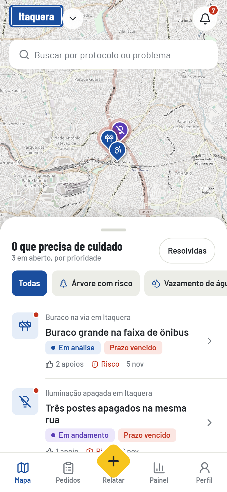
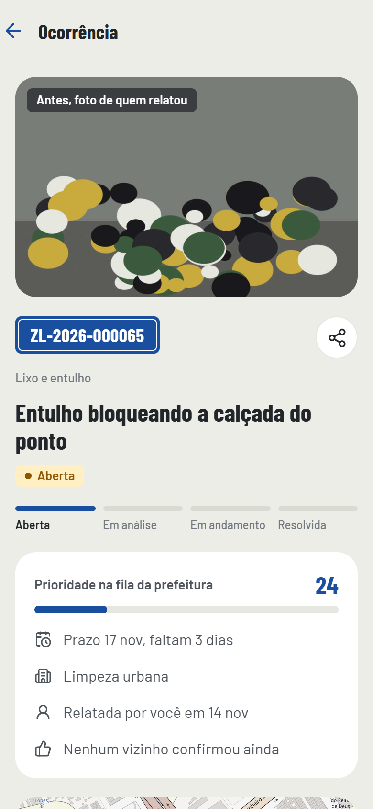
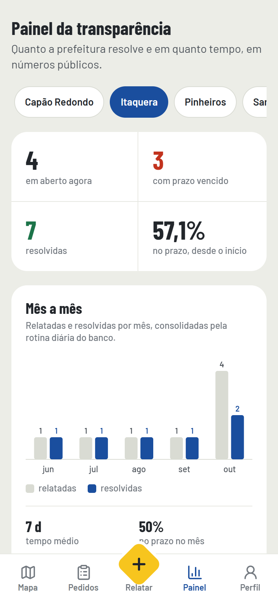

# Zelo · zeladoria urbana centrada no cidadão

**Global Solution 2 (2026), FIAP · CitizenTech** · Yuri Sousa, RM 556163

O cidadão relata buraco, poste apagado, calçada sem acessibilidade ou lixo com foto e local no mapa, a vizinhança confirma, a prefeitura prioriza e todo mundo acompanha o atendimento em público. ODS 11 da ONU.

| | | |
|---|---|---|
|  |  |  |

- **App:** React Native (Expo SDK 57, TypeScript), `mobile/ZeloApp`
- **API:** Spring Boot 4 (Java 21), `backend/zelo-api`
- **Banco:** Oracle 19c com pacotes PL/SQL, triggers e views, `database/`

**Instruções de execução e justificativas:** [README.txt](README.txt)
**Documentação técnica completa** (funcionalidades, arquitetura, memória e eficiência, PL/SQL, API, classes): [docs/DOCUMENTACAO.md](docs/DOCUMENTACAO.md)
**Modelo de dados:** [DER](docs/modelo/DER_Zelo.png) · [MER](docs/modelo/MER_Zelo.png)
