# Zelo: documentação técnica

**Global Solution 2 (2026), FIAP, tema CitizenTech**
Yuri Sousa, RM 556163

O Zelo é um aplicativo de zeladoria urbana: o cidadão relata um problema do espaço público com foto e localização, a vizinhança confirma, a prefeitura prioriza e atende, e todo mundo acompanha o resultado em público.

## Sumário

1. [Problema, público e proposta de valor](#1-problema-público-e-proposta-de-valor)
2. [Funcionalidades](#2-funcionalidades)
3. [Arquitetura](#3-arquitetura)
4. [Tecnologias e benefícios](#4-tecnologias-e-benefícios)
5. [Modelo de dados (DER e MER)](#5-modelo-de-dados-der-e-mer)
6. [Gerenciamento de memória e eficiência](#6-gerenciamento-de-memória-e-eficiência)
7. [Automação em PL/SQL](#7-automação-em-plsql)
8. [API REST](#8-api-rest)
9. [Classes, métodos e funções](#9-classes-métodos-e-funções)
10. [Interface, experiência e acessibilidade](#10-interface-experiência-e-acessibilidade)
11. [Segurança e privacidade](#11-segurança-e-privacidade)
12. [Testes](#12-testes)
13. [Telas](#13-telas)

---

## 1. Problema, público e proposta de valor

**Problema.** Buraco na rua, poste apagado, calçada sem rampa, lixo acumulado: o morador até sabe a quem reclamar, mas o caminho é ruim. O canal da prefeitura pede dados que ele não tem à mão, o mesmo problema é registrado várias vezes por vizinhos diferentes, ninguém sabe em que pé está o pedido e não existe um número público que mostre se o bairro está sendo atendido. Quem mais sofre com isso é quem depende da calçada: idosos, pessoas com deficiência, mães com carrinho de bebê, quem volta a pé do ponto de ônibus à noite.

**Público.** Moradores de áreas urbanas (com atenção especial a idosos e pessoas com deficiência ou mobilidade reduzida) e os gestores das subprefeituras que precisam decidir o que atender primeiro.

**Proposta de valor.**

| Para o cidadão | Para a prefeitura |
|---|---|
| Relatar em menos de um minuto, com foto e local no mapa | Fila sem duplicatas: o app oferece "apoiar" quando o problema já existe |
| Protocolo e prazo na hora, calculados pelo banco | Prioridade objetiva (gravidade, risco, acessibilidade, apoios, espera) |
| Linha do tempo com cada passo e comentário do gestor | Indicadores mensais por bairro gerados automaticamente |
| Painel público: o bairro está sendo atendido? | Rotina diária que marca atrasos e reordena a fila |
| Modo de letras maiores e rótulos para leitor de tela | Avaliação do cidadão depois de cada atendimento |

**ODS da ONU.**

- **ODS 11, Cidades e Comunidades Sustentáveis**, meta 11.7 (espaços públicos seguros, inclusivos e acessíveis) e meta 11.3 (planejamento participativo): a população participa da gestão do próprio bairro e os dados ficam públicos.
- **ODS 10, Redução das Desigualdades**, meta 10.2 (inclusão): a sinalização de barreira de acessibilidade aumenta a prioridade, e o painel por bairro mostra se a periferia é atendida no mesmo ritmo que o centro.
- **ODS 6, Água Potável e Saneamento**, indiretamente: vazamento de água tem o menor prazo (2 dias) e o maior peso, porque cada dia é desperdício.

## 2. Funcionalidades

Login e cadastro existem, mas não contam. As funcionalidades principais são:

| # | Funcionalidade | O que acontece por trás |
|---|---|---|
| 1 | **Relatar problema** com categoria, foto, local (GPS ou toque no mapa), título, detalhes e os sinais "há risco" e "atrapalha acessibilidade" | Foto reduzida no aparelho; consulta de duplicidade a 60 m (`buscar_duplicada`); `pkg_zl_ocorrencia.registrar` gera protocolo, prazo e prioridade; trigger cria a primeira linha do histórico; +10 pontos |
| 2 | **Mapa do bairro** em tela cheia, com busca por protocolo ou título, filtro por categoria, troca de bairro e lista por prioridade; botão **"Também vi esse problema"** | `vw_zl_ocorrencia` com filtros por bind e `FETCH FIRST`; `pkg_zl_ocorrencia.apoiar` impede apoio duplicado ou na própria ocorrência, recalcula a prioridade e avisa o autor |
| 3 | **Acompanhar**: o que relatei e o que apoiei, etapas, prazo, foto de antes e depois, mini mapa, linha do tempo, comentários, compartilhar protocolo, cancelar o próprio pedido e avaliar de 1 a 5 | Histórico gravado por trigger com tipo de evento; `comentar`, `cancelar_pelo_autor` e `avaliar` validam quem pode e quando |
| 4 | **Notificações**: aviso quando o status muda (para quem relatou e quem apoiou), quando o prazo vence, quando alguém apoia e quando alguém comenta; contador no sininho | Gravadas pelo próprio banco (tabela `ZL_NOTIFICACAO`), no mesmo momento da mudança |
| 5 | **Painel da transparência** por bairro ou cidade: em aberto, atrasadas, resolvidas, % no prazo, gráfico de 6 meses, tempo médio, nota média, problemas mais relatados e ranking de participação | `zl_indicador` gerada por `pkg_zl_indicador.gerar_indicadores` (MERGE), `vw_zl_ranking_categoria` |
| 6 | **Área do gestor**: fila por prioridade com filtros (bairro, categoria, só atrasadas), mudança de status com comentário, foto da solução ao resolver, cancelamento só com motivo, botão das rotinas e histórico das execuções | `atualizar_status` valida papel, transição e motivo; `PKG_ZL_INDICADOR` marca atrasos, reordena e consolida; `ZL_LOG_ROTINA` |
| 7 | **Perfil**: nível e pontos, editar nome e bairro, trocar senha, letras maiores | Senha conferida e regravada com BCrypt; preferência salva na conta |

## 3. Arquitetura

```
 ┌──────────────────────────────┐      HTTPS/JSON + JWT       ┌───────────────────────────────┐
 │  App React Native (Expo)     │ ──────────────────────────▶ │  API Spring Boot 4 (Java 21)  │
 │  Android · iOS · Web         │ ◀────────────────────────── │  controllers → services →     │
 │  Leaflet/OSM em WebView      │        gzip, cache          │  repositories (JdbcTemplate)  │
 └──────────────────────────────┘                             └───────────────┬───────────────┘
                                                                              │ JDBC (ojdbc11, Hikari)
                                                              ┌───────────────▼───────────────┐
                                                              │  Oracle 19c (FIAP)            │
                                                              │  PKG_ZL_OCORRENCIA            │
                                                              │  PKG_ZL_INDICADOR · PKG_ZL_LOG│
                                                              │  triggers · views · 9 tabelas │
                                                              └───────────────────────────────┘
```

A decisão central é **deixar a regra de negócio no banco**. A API autentica, valida a forma da entrada, guarda a foto e chama os pacotes PL/SQL. Ela nunca faz `INSERT` ou `UPDATE` direto em `ZL_OCORRENCIA`. Com isso, prazo, prioridade, duplicidade e transição de status valem igual para o app, para o Swagger ou para qualquer script, e a recusa (`RAISE_APPLICATION_ERROR`) chega na tela do cidadão com a mensagem escrita no próprio banco.

## 4. Tecnologias e benefícios

| Camada | Tecnologia | Por que |
|---|---|---|
| App | **React Native 0.86 + Expo SDK 57**, TypeScript | Um código para Android, iOS e web; câmera, GPS e manipulação de imagem prontos (`expo-image-picker`, `expo-location`, `expo-image-manipulator`); tipagem pega erro antes de rodar |
| Navegação | React Navigation 7 (pilha + abas) | Abas diferentes para cidadão e gestor; formulário de relato como modal |
| Mapa | **Leaflet 1.9 + OpenStreetMap** em WebView/iframe | Sem chave de API nem custo; a página do mapa é carregada uma vez e recebe os marcadores por mensagem |
| Ícones e visual | lucide-react-native, expo-linear-gradient | Ícones consistentes e leves (importação só dos usados) |
| API | **Spring Boot 4.1**, Spring Security, Bean Validation | Ecossistema que o curso usou nas fases anteriores; validação declarativa; segurança madura |
| Persistência | **JdbcTemplate + ojdbc11** | As regras estão em PL/SQL: um ORM seria uma camada a mais sem ganho; `CallableStatement` chama os pacotes direto |
| Autenticação | JWT (jjwt) + BCrypt | Sessão sem estado (cabe em vários servidores); senha nunca guardada em texto |
| Documentação da API | springdoc-openapi | Swagger em `/swagger-ui.html` para testar cada rota |
| Banco | **Oracle 19c** com PL/SQL | Exigência da atividade e lugar certo para regra que precisa valer para todos os clientes |
| Ferramentas | Python + oracledb, Node + sharp | Instalador e bateria de testes do banco; DER e MER gerados por código a partir do DDL |

## 5. Modelo de dados (DER e MER)

**MER (conceitual):**

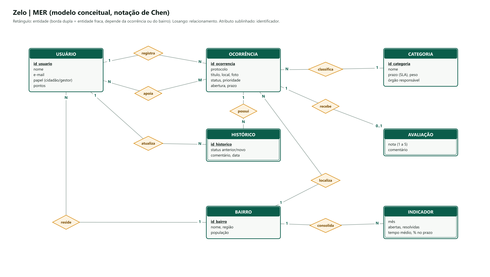

**DER (físico, Oracle):**

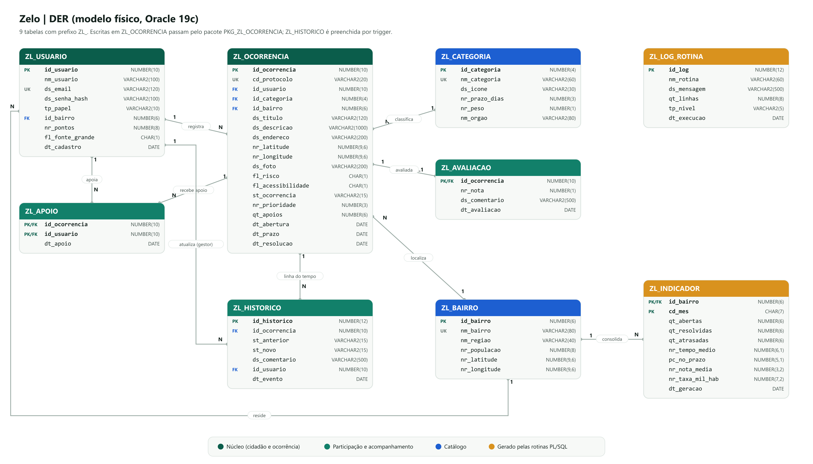

| Tabela | Papel | Destaques |
|---|---|---|
| `ZL_USUARIO` | Cidadão ou gestor | e-mail único, hash BCrypt, papel com `CHECK`, pontos de participação, preferência de letras maiores |
| `ZL_BAIRRO` | Bairros atendidos | população para a taxa por mil habitantes, coordenada do centro |
| `ZL_CATEGORIA` | Tipos de problema | prazo (SLA) em dias, peso 1 a 5, órgão responsável, nome do ícone |
| `ZL_OCORRENCIA` | O problema relatado | protocolo único, status com `CHECK`, prioridade 0 a 100, prazo, flags de risco e acessibilidade, foto do problema e foto da solução |
| `ZL_APOIO` | Vizinho confirmou (N:M) | chave composta impede apoio repetido |
| `ZL_HISTORICO` | Linha do tempo | preenchida por trigger e procedures, com tipo do evento (REGISTRO, STATUS, COMENTARIO, ATRASO), autor e comentário |
| `ZL_AVALIACAO` | Nota do cidadão (1:1) | PK é a própria FK da ocorrência |
| `ZL_INDICADOR` | Consolidação mensal por bairro | PK (bairro, mês), gerada por MERGE |
| `ZL_LOG_ROTINA` | Log das rotinas | gravado em transação autônoma |
| `ZL_NOTIFICACAO` | Avisos para o cidadão e o gestor | tipo (STATUS, ATRASO, APOIO, COMENTARIO), lida S/N; índice `(id_usuario, fl_lida, dt_criacao DESC)` |

Índices criados para os acessos do app: `(id_bairro, st_ocorrencia)` no mapa, `(st_ocorrencia, nr_prioridade DESC)` na fila do gestor, `(id_usuario, dt_abertura DESC)` em "minhas", `(id_ocorrencia, dt_evento)` na linha do tempo.

## 6. Gerenciamento de memória e eficiência

Celular de entrada tem pouca RAM e o plano de dados do público-alvo costuma ser curto. As práticas abaixo estão no código (arquivo indicado entre parênteses).

### 6.1 No aplicativo

| Prática | Onde | Efeito |
|---|---|---|
| **Listas virtualizadas** com `initialNumToRender=6`, `windowSize=7`, `maxToRenderPerBatch=8`, `removeClippedSubviews` | `InicioScreen`, `MinhasScreen`, `FilaScreen` | Só os cards perto da tela ficam montados, a memória não cresce com o tamanho da lista |
| **`React.memo` no card** + `onAbrir(id)` estável via `useCallback` | `OcorrenciaCard.tsx` | Recarregar a lista redesenha só o que mudou |
| **Cancelamento de requisição** com `AbortController` ao sair da tela (`useFocusEffect` e `useEffect` com limpeza) | todas as telas com dados, `config/api.ts` | Resposta que chega depois de a tela fechar não atualiza componente desmontado (sem vazamento nem aviso de estado) |
| **Timeout** em toda requisição (20 s; 45 s no envio com foto) e no GPS (12 s) | `config/api.ts`, `NovaOcorrenciaScreen` | Nenhuma tela fica presa esperando para sempre |
| **Foto reduzida antes do envio**: largura máxima 1024 px, JPEG 55% | `utils/foto.ts` | Foto de 3 a 5 MB vira cerca de 150 KB. No teste, uma imagem de 4000×3000 px saiu com 21 KB |
| **Liberação das referências nativas** da imagem (`release()`) logo após salvar | `utils/foto.ts` | O bitmap decodificado não fica preso na memória nativa |
| **Debounce de 500 ms** na consulta de duplicidade, cancelando a anterior | `NovaOcorrenciaScreen` | Arrastar o marcador não dispara uma requisição por pixel |
| **Mapa carregado uma vez**: HTML em `useMemo`, marcadores e câmera por mensagem | `InicioScreen`, `mapa/mapaHtml.ts` | Trocar de bairro não recarrega o Leaflet nem os blocos do mapa |
| **Ouvinte de `message` removido** ao desmontar | `MapaFrame.web.tsx` | Sem ouvintes acumulados a cada visita à tela |
| **Catálogo em memória + AsyncStorage** | `CatalogoContext.tsx` | Bairros e categorias baixados uma vez; o app abre com a cópia anterior |
| **Token em memória** depois da primeira leitura | `config/api.ts` | Evita ler o armazenamento a cada requisição |
| **Contextos com `useMemo`** e estilos de texto memorizados por escala | `AuthContext`, `useTexto.ts` | Componentes consumidores só renderizam quando o valor muda de verdade |
| **Ícones importados um a um** (mapa nome → componente) | `Icone.tsx` | Pacote do app sem a biblioteca de ícones inteira |
| A lista não traz descrição nem histórico (`temFoto` em vez da foto) | DTO `OcorrenciaResumo` | Resposta leve; o detalhe completo só quando abre |

### 6.2 Na API

| Prática | Efeito |
|---|---|
| **Teto de linhas no banco** (`FETCH FIRST n ROWS`, máximo 200) | Nunca traz a cidade inteira para a memória da API ou do celular |
| **Compressão gzip** das respostas JSON acima de 1 KB | Lista do mapa: 7.760 bytes sem gzip, 1.539 com gzip (medido com curl) |
| **Cache-Control**: catálogo 1 h, fotos 30 dias `immutable` | Repetir a consulta não custa banco nem rede |
| **Pool Hikari pequeno** (5 conexões, ociosa devolvida em 2 min) | Respeita o limite de sessões do schema de aluno e não segura recurso parado |
| **JWT lido sem ir ao banco** (id e papel vêm assinados no token) | Uma consulta a menos por requisição |
| **Records imutáveis** como DTO, sem entidades gerenciadas | Nada de cache de primeiro nível nem proxies de ORM na memória |
| **Foto conferida antes de abrir transação** (tamanho máximo 1,5 MB, tipo pela assinatura do arquivo) | Entrada ruim é recusada no ponto mais barato |
| Foto em disco, só o nome no banco | Consultas e backup do schema continuam leves |

### 6.3 No banco

| Prática | Efeito |
|---|---|
| **`BULK COLLECT ... LIMIT 200` + `FORALL`** em `recalcular_prioridades` | Memória da sessão constante, um envio ao motor SQL por lote |
| **`MERGE`** em `gerar_indicadores` | Rodar duas vezes atualiza em vez de duplicar |
| **Pré-filtro por caixa de coordenadas** antes de calcular distância em `buscar_duplicada` | Calcula distância só para ocorrências próximas |
| `UPDATE ... WHERE nr_prioridade <> v_nova` | Não reescreve linha que não mudou (menos redo e undo) |
| Índices compostos alinhados às consultas do app | Mapa, fila e "minhas" sem varredura completa |
| Sequences `NOCACHE` | Sem buracos grandes nos protocolos após reinício do banco compartilhado |

## 7. Automação em PL/SQL

Scripts em `database/`, executados em ordem por `executar_scripts.py`.

### 7.1 `PKG_ZL_OCORRENCIA` (ciclo de vida da ocorrência)

| Rotina | Tipo | O que faz |
|---|---|---|
| `distancia_m(lat1, lon1, lat2, lon2)` | function `DETERMINISTIC` | Distância aproximada em metros (equirretangular) |
| `calcular_prioridade(id)` | function | Nota 0 a 100 (fórmula abaixo); 0 para encerradas |
| `calcular_prazo(categoria, risco, abertura)` | function | SLA da categoria; com risco, metade (mínimo 1 dia) |
| `gerar_protocolo(id, abertura)` | function | `ZL-AAAA-NNNNNN` |
| `buscar_duplicada(categoria, lat, lon)` | function | Ocorrência aberta da mesma categoria a até 60 m |
| `registrar(...)` | procedure | Valida usuário, categoria, bairro, título e coordenada; recusa duplicata; insere com protocolo, prazo e prioridade; +10 pontos; log |
| `apoiar(ocorrencia, usuario, OUT apoios, OUT prioridade)` | procedure | Recusa apoio na própria, em encerrada ou repetido; incrementa e recalcula; +2 pontos |
| `atualizar_status(ocorrencia, gestor, status, comentario, foto_solucao)` | procedure | Exige papel GESTOR e transição válida (ABERTA, EM_ANALISE, EM_ANDAMENTO, RESOLVIDA; CANCELADA nas duas primeiras, só com motivo de 5+ letras); foto da solução só em RESOLVIDA; +5 pontos ao autor; avisa autor e apoiadores |
| `avaliar(ocorrencia, usuario, nota, comentario)` | procedure | Só o autor, só depois de resolvida, nota de 1 a 5, uma vez |
| `comentar(ocorrencia, usuario, texto)` | procedure | Autor, apoiador ou gestor; ocorrência não encerrada; 3 a 500 letras; vira evento COMENTARIO e avisa quem acompanha |
| `cancelar_pelo_autor(ocorrencia, usuario, motivo)` | procedure | Só o autor, só enquanto ABERTA, motivo de 5+ letras; devolve os 10 pontos do registro (não vale registrar e cancelar para subir no ranking) |
| `normalizar(texto)` | function | Remove acento e caixa para a busca por título |

**Prioridade** = peso da categoria × 8 (até 40) + apoios × 4 (até 24) + 15 se há risco + 10 se afeta acessibilidade + dias em aberto (até 15) + 10 se o prazo venceu, limitada a 100.

**Códigos de recusa:** -20101 usuário inexistente, -20102 categoria, -20103 bairro, -20104 título curto, -20105 duplicada (a mensagem leva `[id=N]`, que a API transforma em `referenciaId`), -20106 apoio na própria, -20107 encerrada, -20108 apoio repetido, -20109 não é gestor, -20110 transição inválida, -20111 não é o autor, -20112 ainda não resolvida, -20113 já avaliada, -20114 nota inválida, -20115 ocorrência inexistente, -20116 coordenada inválida, -20117 cancelamento sem motivo, -20118 comentário fora de 3 a 500 letras, -20119 sem permissão para comentar, -20120 campo imutável, -20121 não é o autor, -20122 autor só cancela enquanto aberta, -20123 foto de solução fora de RESOLVIDA, -20124 notificação inexistente. A API converte cada faixa em status HTTP (404, 409, 403 ou 400).

### 7.2 `PKG_ZL_NOTIFICACAO` (avisos)

| Rotina | O que faz |
|---|---|
| `status_alterado` | Avisa autor e apoiadores da troca de status (menos quem fez a troca) |
| `atraso` | Avisa o autor quando a rotina diária encontra o prazo vencido |
| `apoio_recebido` | Avisa o autor que um vizinho confirmou o problema |
| `comentario_novo` | Avisa autor e apoiadores, menos quem comentou |
| `marcar_lida`, `marcar_todas`, `nao_lidas` | Leitura e contador do sininho |

Os avisos de status saem da procedure, não do trigger: assim não duplicam, e um UPDATE feito por fora da aplicação continua gerando histórico, mas não dispara aviso.

### 7.3 `PKG_ZL_INDICADOR` (acompanhamento e transparência)

| Rotina | O que faz |
|---|---|
| `detectar_atrasos(OUT qt)` | Insere na linha do tempo `[ATRASO] Prazo vencido...` para cada ocorrência aberta com prazo vencido, sem repetir |
| `recalcular_prioridades(OUT qt)` | Recalcula a fila inteira em lotes (BULK COLLECT/FORALL), porque o tempo de espera muda a nota todo dia |
| `gerar_indicadores(mes, OUT qt)` | MERGE por bairro: abertas, resolvidas, atrasadas, tempo médio, % no prazo, nota média, taxa por mil habitantes |
| `executar_rotina_diaria` | As três em sequência, com COMMIT e log; ponto de entrada do job |
| `pc_no_prazo_bairro(bairro)` | Function usada em consultas |

### 7.4 `PKG_ZL_LOG`, triggers, views e job

- `pkg_zl_log.registrar`: `PRAGMA AUTONOMOUS_TRANSACTION`, o log fica gravado mesmo se a rotina que chamou fizer rollback.
- `trg_zl_ocorrencia_ai`: primeira linha da linha do tempo ao registrar.
- `trg_zl_ocorrencia_status_au`: toda troca de status vira histórico, com o gestor e o comentário passados pelo pacote; se alguém mudar o status direto por SQL, a linha é gravada assim mesmo.
- `trg_zl_ocorrencia_imutavel_bu`: protocolo, autor e data de abertura não mudam (são a prova do cidadão).
- `vw_zl_ocorrencia` (lista e detalhe já com nomes e indicador de atraso) e `vw_zl_ranking_categoria`.
- `07_job.sql`: agenda `executar_rotina_diaria` às 6h com `DBMS_SCHEDULER`. Sem o privilégio CREATE JOB (caso do schema da FIAP), registra aviso no log e segue; a rotina fica disponível no botão do gestor.

## 8. API REST

Base `http://localhost:8080/api`. Documentação interativa em `/swagger-ui.html`.

| Método e rota | Acesso | Descrição |
|---|---|---|
| `POST /auth/login` | público | Devolve JWT e perfil |
| `POST /auth/cadastro` | público | Cria conta de cidadão |
| `GET /usuarios/me` | logado | Perfil com pontos e contadores |
| `PATCH /usuarios/me/preferencias` | logado | Liga/desliga letras maiores |
| `GET /catalogo/bairros`, `/catalogo/categorias` | público | Tabelas de apoio (cache 1 h) |
| `GET /ocorrencias?bairroId&categoriaId&busca&incluirEncerradas&limite` | público | Lista do mapa por prioridade, com busca por protocolo ou título (sem acento) |
| `GET /ocorrencias/{id}` | público | Detalhe com linha do tempo |
| `GET /ocorrencias/duplicada?categoriaId&lat&lon` | público | 200 com a existente ou 204 |
| `GET /ocorrencias/minhas`, `/ocorrencias/apoiadas` | logado | Acompanhamento |
| `POST /ocorrencias` | logado | Registrar (foto opcional em base64) |
| `POST /ocorrencias/{id}/apoios` | logado | Apoiar |
| `POST /ocorrencias/{id}/avaliacao` | logado | Avaliar |
| `POST /ocorrencias/{id}/comentarios` | logado | Acrescentar informação na linha do tempo |
| `POST /ocorrencias/{id}/cancelar` | logado (autor) | Cancelar o próprio pedido com motivo |
| `GET /notificacoes`, `GET /notificacoes/nao-lidas` | logado | Avisos e contador |
| `POST /notificacoes/{id}/lida`, `POST /notificacoes/lidas` | logado | Marcar como lida |
| `PUT /usuarios/me`, `POST /usuarios/me/senha` | logado | Editar nome e bairro, trocar senha |
| `GET /painel?bairroId` | público | Painel da transparência |
| `GET /fotos/{nome}` | público | Foto (cache 30 dias) |
| `GET /gestor/fila?bairroId&categoriaId&somenteAtrasadas` | gestor | Fila por prioridade com filtros |
| `PATCH /gestor/ocorrencias/{id}/status` | gestor | Avançar status com comentário e, ao resolver, foto da solução |
| `POST /gestor/rotinas?mes` | gestor | Rodar atrasos, prioridades e indicadores |
| `GET /gestor/logs` | gestor | Últimas execuções |

Erro sempre no mesmo formato: `{ instante, status, mensagem, caminho, referenciaId }`.

## 9. Classes, métodos e funções

### 9.1 Backend (`backend/zelo-api/src/main/java/br/com/fiap/zelo`)

| Classe | Responsabilidade e métodos principais |
|---|---|
| `ZeloApiApplication` | Ponto de entrada (`main`) |
| `config.SecurityConfig` | Regras de acesso por rota e papel; `passwordEncoder()` (BCrypt); `cors()` com lista fechada de origens |
| `config.OpenApiConfig` | Metadados do Swagger e esquema Bearer |
| `security.JwtService` | `gerar(id, papel)` emite token HS256; `ler(token)` valida e devolve `UsuarioLogado` |
| `security.JwtAuthFilter` | Lê `Authorization: Bearer`, coloca o usuário no contexto; token inválido segue anônimo |
| `security.UsuarioLogado` | Record `(id, papel)` com `gestor()` |
| `exception.OracleErrors` | `traduzir(DataAccessException)`: extrai `ORA-20xxx`, limpa a pilha e separa `[id=N]` |
| `exception.RegraNegocioException` | Código Oracle, mensagem e `referenciaId` |
| `exception.GlobalExceptionHandler` | Converte exceções em `ErroResponse` com o status certo |
| `repository.UsuarioRepository` | `credencialPorEmail`, `emailEmUso`, `inserir`, `perfil`, `atualizarFonteGrande` |
| `repository.CatalogoRepository` | `bairros()`, `categorias()` |
| `repository.OcorrenciaRepository` | Consultas: `listar`, `doUsuario`, `apoiadasPor`, `fila`, `detalhe`, `duplicada`; chamadas aos pacotes: `registrar`, `apoiar`, `atualizarStatus`, `avaliar`; `primeiroNome` abrevia o sobrenome |
| `repository.PainelRepository` | `agora`, `meses`, `categorias`, `cidadaos`, `executarRotinas`, `logs` |
| `repository.Colunas` | Leitura de colunas que podem ser nulas |
| `service.AuthService` | `login` (mesma mensagem para e-mail e senha errados), `cadastrar`, `perfil`, `atualizarFonte` |
| `service.OcorrenciaService` | Casos de uso; `registrar` valida a foto antes do banco e apaga o arquivo se a transação falhar |
| `service.FotoService` | `validar` (tamanho e assinatura JPG/PNG), `gravar` (nome UUID), `localizar` (bloqueia path traversal), `apagar` |
| `repository.NotificacaoRepository` / `service.NotificacaoService` / `controller.NotificacaoController` | Avisos: listar, contar, marcar lida, marcar todas (chamam `PKG_ZL_NOTIFICACAO`) |
| `service.PainelService` | `painel`, `executarRotinas` (numa transação), `logs` |
| `controller.*` | `AuthController`, `CatalogoController`, `OcorrenciaController`, `PainelController`, `GestorController`, `FotoController`: rotas da seção 8 |
| `dto.*Dtos` | Records de entrada (com Bean Validation) e saída |

### 9.2 Aplicativo (`mobile/ZeloApp/src`)

| Arquivo | Responsabilidade |
|---|---|
| `config/api.ts` | `urlBase()`, `urlFoto()`, `lerToken/salvarToken/apagarToken`, `api.get/post/patch` com timeout, cancelamento e `ErroApi`; `foiCancelada()` |
| `services/zelo.ts` | `authApi`, `catalogoApi`, `ocorrenciaApi`, `painelApi`, `gestorApi`: uma função por rota, já tipada |
| `context/AuthContext.tsx` | Sessão: `entrar`, `cadastrar`, `sair`, `recarregar`, `definirFonteGrande` (atualiza na hora e confirma no servidor) |
| `context/CatalogoContext.tsx` | Bairros e categorias em memória e AsyncStorage; `categoriaPorId`, `bairroPorId` |
| `hooks/useTexto.ts` | Estilos de texto com a escala de letras maiores |
| `utils/foto.ts` | `obterFoto(origem)`: permissão, câmera/galeria, redimensiona, comprime e libera memória nativa |
| `utils/formato.ts` | `dataCurta`, `dataHora`, `nomeMes`, `prazoRelativo`, `pct` |
| `theme/tema.ts` | Cores, status (rótulo, cor, etapa), `proximosStatus` (espelha a regra do PL/SQL), `corPrioridade`, sombras |
| `components/ui.tsx` | `Botao`, `Campo`, `Chip`, `StatusBadge`, `Faixa` (mensagem na tela, funciona na web), `Carregando`, `Vazio`, `Cartao` |
| `components/OcorrenciaCard.tsx` | Card memorizado da lista, com barra de prioridade opcional |
| `components/Icone.tsx` | Ícone da categoria pelo nome guardado no banco |
| `components/mapa/*` | `mapaHtml()` (página Leaflet e protocolo de mensagens), `MapaFrame` (WebView no celular, iframe na web) |
| `navigation/Navegacao.tsx` | Pilha raiz e abas diferentes para cidadão e gestor |
| `screens/EntrarScreen` | Entrada, cadastro com escolha de bairro e atalhos de demonstração |
| `screens/InicioScreen` | Mapa + lista por prioridade, filtro por bairro e "incluir resolvidas" |
| `screens/NovaOcorrenciaScreen` | Formulário em 4 passos, duplicidade, envio e tela de protocolo |
| `screens/DetalheScreen` | Etapas, prioridade, prazo, apoio, avaliação, ações do gestor e linha do tempo |
| `screens/ApresentacaoScreen` | Três passos do primeiro uso, com ilustrações feitas de pedaços da interface |
| `screens/MinhasScreen` | "Que eu relatei" e "Que eu apoiei", com resumo por situação |
| `screens/NotificacoesScreen` | Avisos com tipo, marcar lida ao abrir e marcar todas |
| `screens/EditarPerfilScreen` | Nome, bairro e troca de senha |
| `screens/LogsScreen` | Histórico das execuções das rotinas (gestor) |
| `screens/PainelScreen` | Indicadores, mês a mês, categorias e ranking |
| `screens/PerfilScreen` | Nível e pontos, letras maiores, ODS, sair |
| `screens/FilaScreen` | Fila do gestor e botão das rotinas |

## 10. Interface, experiência e acessibilidade

**Identidade visual.** A marca sai do próprio mundo da zeladoria de São Paulo, em vez de um tema genérico de aplicativo:

| Token | Valor | Origem e uso |
|---|---|---|
| Azul placa | `#1A4E9E` | Azul das placas com nome de rua. Cor principal e o elemento-assinatura **placa** (retângulo azul com filete branco), usado no logo, no protocolo e no bairro |
| Amarelo sinalização | `#F7C51E` | Amarelo da sinalização viária. Reservado para a ação de relatar e para o apoio |
| Pedra de calçada | `#ECEDE7` | Fundo das telas |
| Tinta | `#22262B` | Texto principal |
| Vermelho alerta | `#C2331E` | Risco e prazo vencido |
| Verde resolvido | `#1C7449` | Resolvidas |

Tipografia: **Barlow Condensed** nos títulos e números (desenho derivado das placas de trânsito) e **Barlow** no texto. Raios por hierarquia: placa e etiquetas pequenos (6 px), campos 10 px, blocos 22 px, folha do mapa 28 px. As listas usam linhas com divisória dentro de um bloco, não pilhas de cartões iguais com sombra.

**Fluxo e experiência.**
- Apresentação de 3 passos no primeiro uso, com ilustrações montadas a partir de pedaços reais da interface.
- Mapa em tela cheia; a lista fica numa folha que expande com um toque na alça. A placa do bairro no topo abre a troca de bairro.
- Relatar em 4 passos numerados (é de fato uma sequência); categoria já mostra prazo e órgão; o bairro é escolhido sozinho pelo ponto marcado; aviso de duplicata com a opção de apoiar.
- Feedback sempre na tela: faixas de sucesso, erro e aviso com `accessibilityLiveRegion`; esqueletos de carregamento no formato do conteúdo; estados vazios que dizem o que fazer.

**Acessibilidade.**
- Letras maiores (+22%) salvas na conta; abas, botões e números crescem junto.
- Rótulos para leitor de tela em botões, linhas, marcadores do mapa, estrelas, gráfico e etapas; papéis `button`, `tab`, `radio`, `switch`, `header`.
- Alvos de toque de 44 a 52 px; contraste acima de 4,5:1; status sempre com texto, nunca só por cor.

## 11. Segurança e privacidade

- Senhas com BCrypt; login responde igual para e-mail inexistente e senha errada.
- JWT com validade de 7 dias e segredo configurável por variável de ambiente.
- Rotas do gestor protegidas por papel na API e também no PL/SQL (`atualizar_status` confere o papel).
- Credenciais do Oracle fora do repositório (`config/oracle.properties` no `.gitignore`).
- Foto validada pelo conteúdo, com nome aleatório e proteção contra path traversal.
- CORS com lista fechada de origens.
- LGPD: no mapa e no ranking públicos aparece só o primeiro nome e a inicial do sobrenome; e-mail nunca é exposto.

## 12. Testes

- `database/testar_regras.py`: 48 casos contra o Oracle da FIAP (cada procedure, cada recusa, triggers, BULK COLLECT, MERGE idempotente, detecção de atraso sem repetição). Roda em transação desfeita no fim. Resultado: **48/48**, incluindo comentários, cancelamento pelo autor, motivo obrigatório do gestor, foto da solução e as notificações nos quatro casos.
- API testada ponta a ponta com curl: login, cadastro, registro com foto, duplicidade (409 com `referenciaId`), apoio, fluxo do gestor, avaliação, rotinas, painel, 401/403 nas rotas protegidas.
- App testado no navegador (Expo web) como cidadã, idoso com letras maiores e gestor; `npx tsc --noEmit` sem erros.
- Revisão de design e funcionalidade por um agente de QA em 4 rodadas, comparando com apps de cidade (Colab, 1746, SP156, FixMyStreet). Cada rodada apontou correções com print, todas aplicadas; a última não encontrou pendência.

## 13. Telas

| | | |
|---|---|---|
| 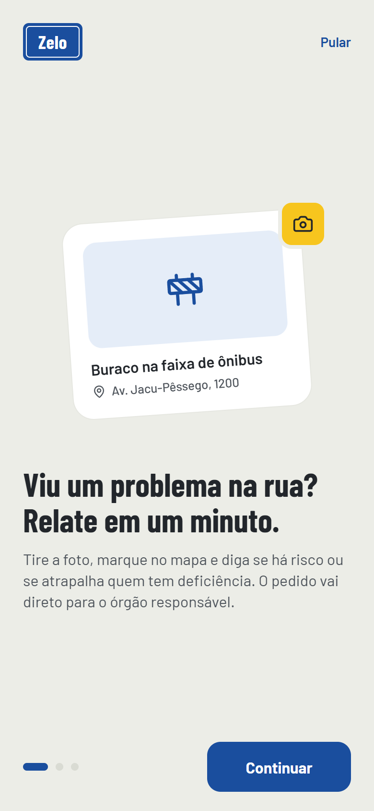 | 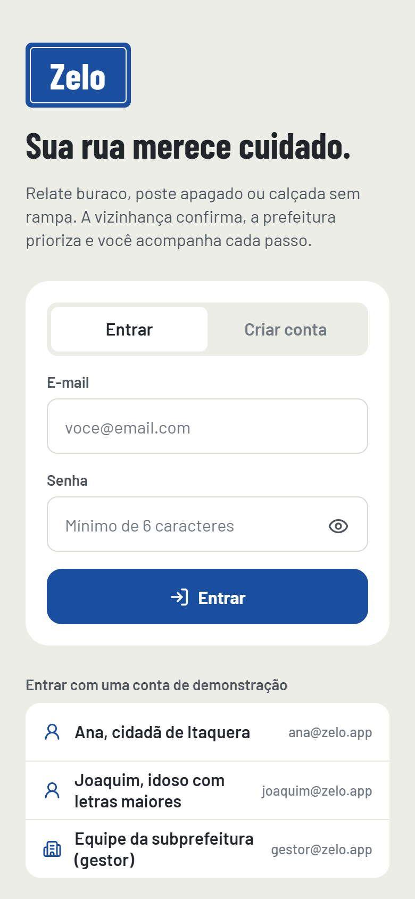 | 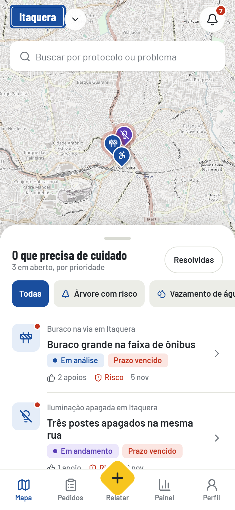 |
| Apresentação do primeiro uso | Entrada e contas de demonstração | Mapa do bairro com pinos por categoria |
| 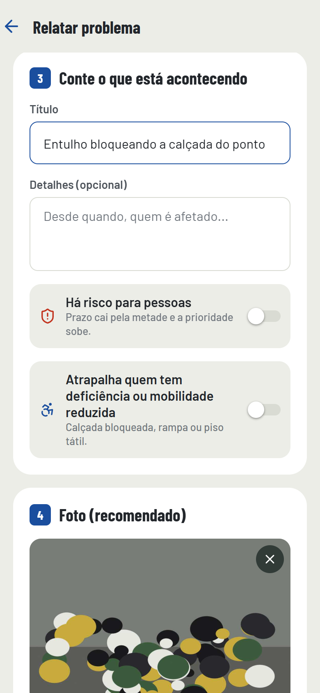 | 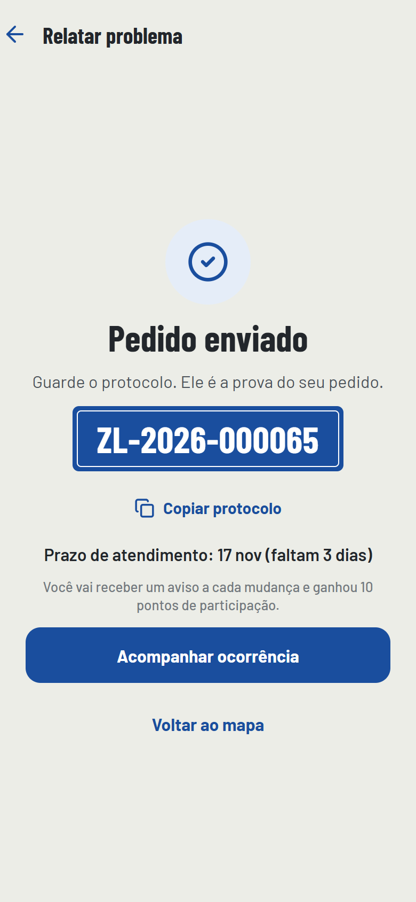 | 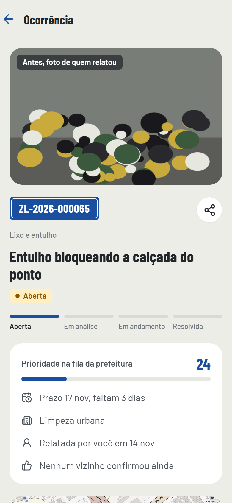 |
| Relatar com foto reduzida no aparelho | Comprovante com protocolo e prazo | Detalhe com foto, etapas e prioridade |
| 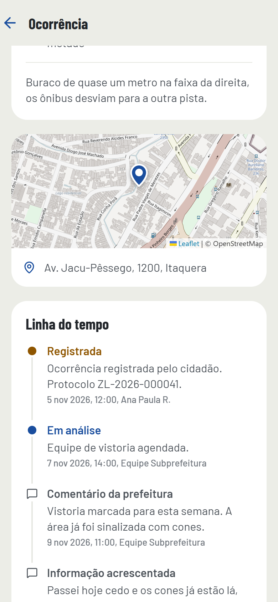 |  | 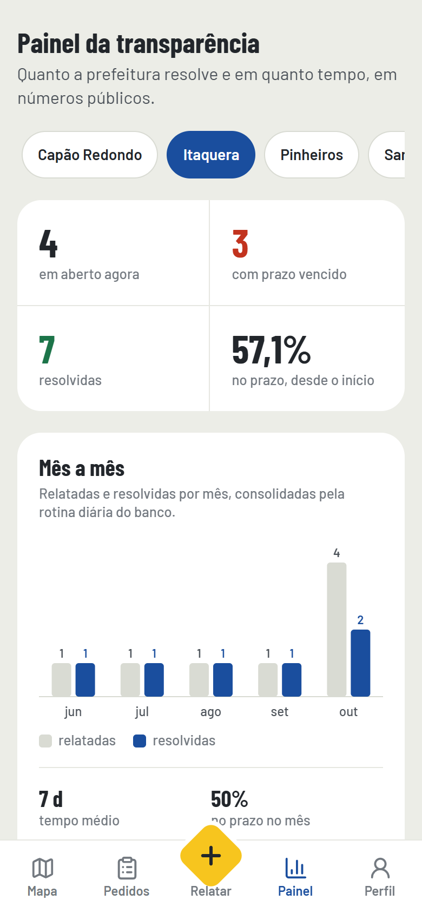 |
| Linha do tempo com comentários | Notificações geradas pelo banco | Painel e gráfico mês a mês |
| 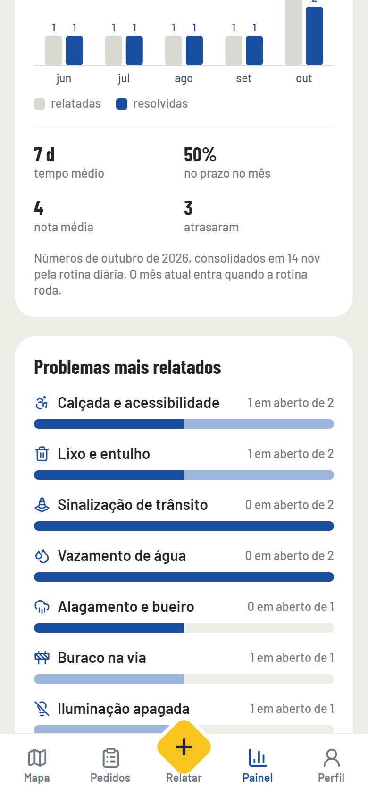 |  | 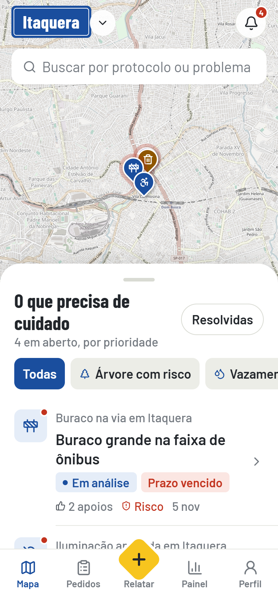 |
| Problemas mais relatados | Perfil, pontos e acessibilidade | Modo letras maiores (Joaquim) |
| 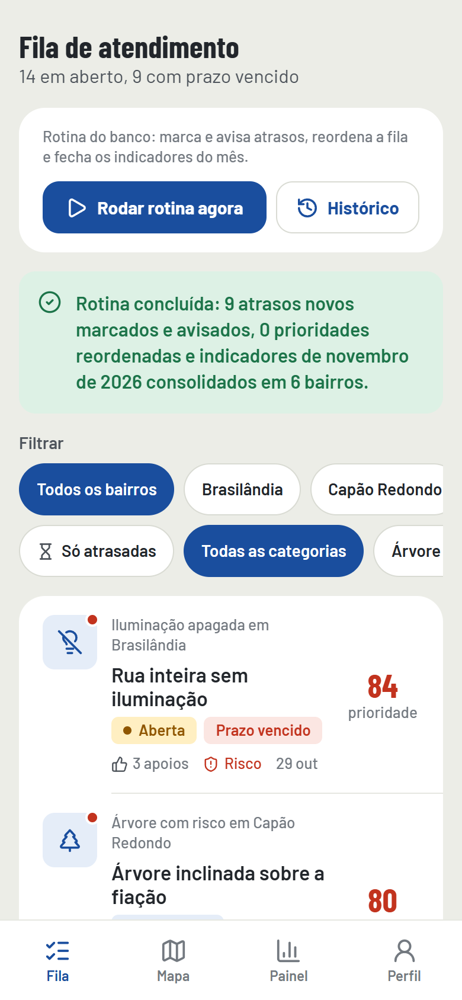 | 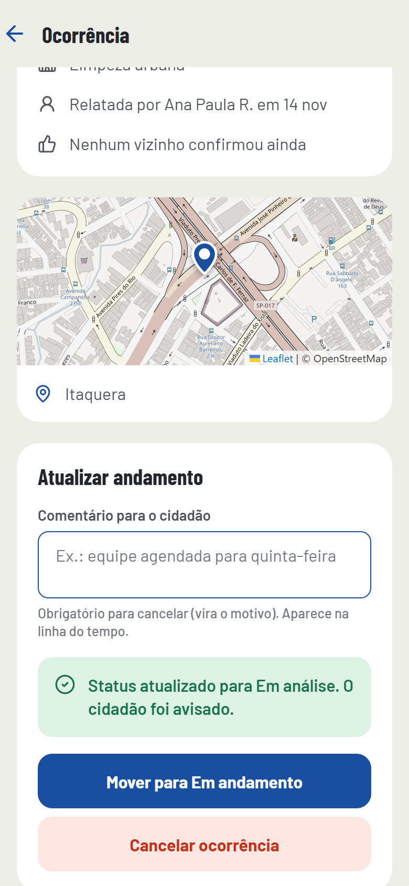 | |
| Fila do gestor e rotina diária | Gestor atualizando o andamento | |
